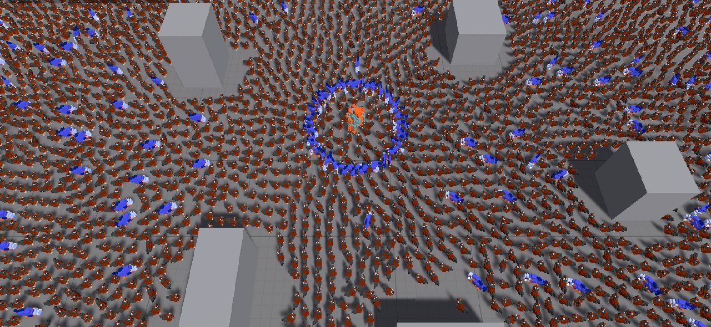

# DOTS Crowd Showcase

200,000 enemies chase and surround the player, built with Unity DOTS (Entities, Burst, Jobs).
There is no NavMesh and no physics. Each agent looks at its neighbours on a spatial hash grid
and picks one of 8 directions with context steering.

## Performance

Release build at 1920x1080 with auto-fire on, so bullets, kills and respawns are all running.
Tested on an RTX 3050 Laptop with a Ryzen 5 7235HS.

| Agents | Average | 1% low | Worst frame |
|---|---|---|---|
| 150,000 | 115 fps | 80 fps | 15.2 ms |
| **200,000 (default)** | **91 fps** | **64 fps** | 21.1 ms |
| 225,000 | 82 fps | 58 fps | 21.8 ms |

The CPU is the limit. The GPU frame is about 2.5 ms.

## How it works

The whole frame is one job chain, and the main thread never waits on it in the middle.

- **Grid:** agent positions go into a counting-sort hash grid. The prefix sum runs in parallel blocks.
- **Steering:** each agent marks the blocked directions from nearby agents and obstacles, then takes
  the free direction closest to the player. Agents near the camera re-plan every 4 frames, distant ones every 12.
- **Movement:** a chunk where nothing moved isn't written to, so a settled crowd costs almost nothing
  in transforms and GPU uploads.
- **Combat:** bullets and enemy shots come from fixed pools. Dead enemies play a death animation
  and come back on the outer ring. Nothing is created or destroyed at runtime, so there are no structural changes.
- **Animation:** done in the vertex shader (walk cycle, attack swing, death, idle breathing).
  Idle agents need no CPU writes at all.

## Running

Unity 6000.3.13f1. Open `Assets/Scenes/Swarm.unity` and press Play.

| Input | Action |
|---|---|
| WASD / arrows | Move |
| Mouse | Aim |
| LMB / Space | Fire |
| T | Toggle auto-fire |
| Mouse wheel | Zoom |

Build options:

- `-agents 100000` sets the crowd size.
- `-benchmark` turns on auto-fire, warms up for 5 s, measures for 40 s, writes `benchmark.txt` next to the exe and quits.

EditMode tests for the steering and the grid are in `Assets/Tests`.

## Credits

The voxel models are CC0, from OpenGameArt:
[Voxel creature pack1](https://opengameart.org/content/voxel-creature-pack1) (rooster, footed piranha) and
[Voxel Mech & Sniper](https://opengameart.org/content/voxel-mech-sniper).
